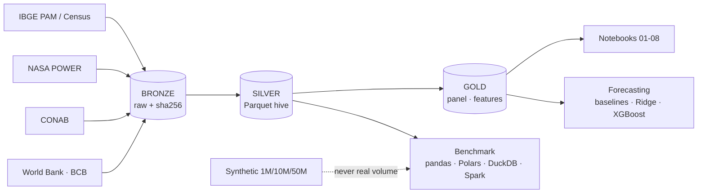

# Project 02 · Coffee Big Data Intelligence

[🇧🇷 Português](README.md) · 🇺🇸 English

A data engineering and data science pipeline for **Brazilian coffee**, focused on **São Paulo (arabica)** and designed to expand nationally. It integrates municipal production (IBGE/PAM), climate (NASA POWER), crop estimates (CONAB), international prices (World Bank) and FX/CPI (BCB) in **bronze → silver → gold** layers, with **incremental, idempotent ingestion**, data quality tests, analyses, forecasting and an **engine benchmark** (pandas, Polars, DuckDB, PySpark).

> ### ⚠️ Data volume notice
> The **real** data in this project is small: the largest table (daily climate) has **759,760 rows**, and the modelling panel has **1,663 eligible rows (≈ 13 independent harvests)**. **This is not Big Data.** The 1M, 10M and 50M-row benchmarks use **synthetic** data generated only to measure engine behaviour; they must **never** be read as coffee-sector data volume. See [docs/pt-BR/03_volume_real_vs_sintetico.md](docs/pt-BR/03_volume_real_vs_sintetico.md) (Portuguese).

> Documentation in `docs/pt-BR/` and the notebooks are written in Portuguese. This README summarises the project in English.

## Questions answered (notebook 08)

1. **Which regions are most productive?** Ribeirão Preto (≈ 1,725 kg/ha) and Campinas (≈ 1,573) hold ≈ 69% of the area; Presidente Prudente, Araçatuba and São José do Rio Preto are clearly lower (≈ 990–1,120). Assis has the highest point estimate (≈ 1,982) but a wide CI that does **not** separate it from Ribeirão Preto.
2. **How did production evolve?** São Paulo production fell ≈ 74% from its 1981 peak; harvested area dropped from ≈ 908 to ≈ 194 thousand ha, while yield (5-year mean) rose from ≈ 1,287 to ≈ 1,618 kg/ha.
3. **What is the climate–yield relationship?** **No association distinguishable from zero** for the 6 climate features (year-block bootstrap CIs include 0). This does **not** show climate is irrelevant: 55 km resolution, ≈ 13 harvests and a noisy target hide effects.
4. **Can regional production be forecast?** At state level, mean absolute error is ≈ 7% (vs ≈ 14% for "repeat last year"). By mesoregion and by municipality, **no trained model consistently beats a simple lag average**.

## Key results (and methodological honesty)

- Strong **biennial bearing** at state level (lag-1 autocorrelation ≈ −0.64 for CONAB production; ≈ 91% of years flip the sign of the change).
- **38.5% of year-to-year arabica pairs have an identical yield** in PAM: the data are **estimates**, which caps municipal forecasting and attenuates correlations.
- **Ridge instability** in early folds due to extrapolation of year-level covariates (diagnosed and documented, not hidden).
- **Conformal intervals** with ≈ 80% average coverage, but ≈ 65% to ≈ 87% by year.
- **Benchmark:** for the real volume any local engine finishes in milliseconds; **Spark was not faster at any tested size (up to 50M)** on a 14-core single node — the distributed scenario was **not measured**.

## Source and dependency verification status

| Item | Status |
|---|---|
| IBGE SIDRA/PAM, localities, 2022 Census | ✅ verified, in use |
| NASA POWER | ✅ verified, in use |
| CONAB (gov.br) | ✅ in use (**CC BY-ND**: do not redistribute derivatives) |
| World Bank (Pink Sheet) | ✅ in use; **licence not confirmed** |
| BCB SGS | ✅ in use; **terms not checked in detail** |
| **INMET** | ❌ **unavailable** (TLS failure; **not** bypassed) |
| Producer price | ❌ not included (no source with confirmed methodology/access) |
| PySpark | ✅ requires Java |
| MLflow | optional (`USE_MLFLOW=1`, SQLite backend) |

## Architecture



## Quick start

```bash
python3.11 -m venv .venv && source .venv/bin/activate
pip install -r requirements.txt && pip install -e .
python scripts/run_pipeline.py all --ufs 35     # ingest + silver + gold + quality (needs internet)
python scripts/build_notebooks.py && python scripts/run_notebooks.py
pytest -q
```

Benchmark (optional; creates ≈ 0.6 GB of synthetic data outside git): `python scripts/run_benchmark.py`. Full steps in [docs/pt-BR/12_reproducao.md](docs/pt-BR/12_reproducao.md).

## Notebooks

| # | Notebook | Topic |
|---|---|---|
| 01 | `01_exploracao_fontes` | source verification and limits |
| 02 | `02_limpeza_qualidade` | special values, IBGE check digit, the `pivot_table` bug, repeated yields |
| 03 | `03_eda_cafeicultura` | evolution, concentration, inequality |
| 04 | `04_clima_produtividade` | phenological windows, anomalies, year-block bootstrap |
| 05 | `05_series_temporais` | biennial bearing, rolling origin, intervals, price vs production |
| 06 | `06_previsao_producao` | scenarios A/B, ablations, conformal, leakage, XGBoost |
| 07 | `07_benchmark_bigdata` | real vs synthetic, time, memory, partitions, generator |
| 08 | `08_insights_negocio` | the 4 questions, scenarios, recommendations |

All executed on the real downloaded data; outputs are stored in the `.ipynb` files.

## What this project does **not** claim

That coffee is Big Data; that climate causes (or does not cause) yield; that Spark is inferior in general; that forecasts are suitable for credit or investment without further validation. Modelling scope: **SP, arabica, 2012+**.

## Licences

Code: set according to your organisation's policy. **Data** is not redistributed (`data/` is git-ignored); respect each source's terms (CONAB: CC BY-ND).

## Repository, versioning and running on another machine

Published from the original development machine (macOS, Podman). This has **not** been run on GitHub Codespaces or Docker Desktop; if you run it there, treat it as a first verification and compare with the tests section.

- **Not versioned:** `data/lake/`, `data/bench/`, `data/external/`, `mlruns/`, `logs/`, `.tools/`. Rebuild the lake with `python scripts/run_pipeline.py all --ufs 35` (**internet required**). The optional benchmark generates ≈ 0.6 GB of synthetic data outside git.
- **Versioned:** `src/`, `scripts/`, executed notebooks, tests, `docs/pt-BR/`. Full steps: `docs/pt-BR/12_reproducao.md` (Portuguese).
- **Code licence:** GPL-3.0 (`LICENSE`). Third-party data/model licences and attributions: see the sections and docs above.
