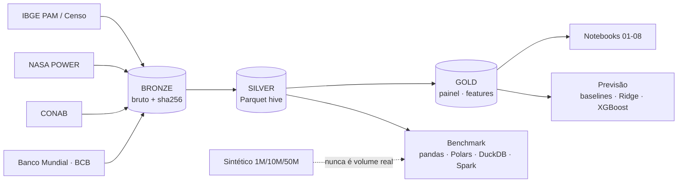

# Projeto 02 · Coffee Big Data Intelligence

🇧🇷 Português · [🇺🇸 English](README.en.md)

Pipeline de engenharia e ciência de dados para a **cafeicultura brasileira**, com foco em **São Paulo (arábica)** e arquitetura preparada para expansão nacional. Integra produção municipal (IBGE/PAM), clima (NASA POWER), estimativas de safra (CONAB), preços internacionais (Banco Mundial) e câmbio/IPCA (BCB), em camadas **bronze → silver → gold**, com ingestão **incremental e idempotente**, testes de qualidade, análises, previsão e **benchmark de engines** (pandas, Polars, DuckDB, PySpark).

> ### ⚠️ Aviso sobre volume de dados
> O volume **real** deste projeto é pequeno: a maior tabela (clima diário) tem **759 760 linhas** e o painel de modelagem tem **1 663 linhas elegíveis (≈ 13 safras independentes)**. **Isso não é Big Data.** Os benchmarks de 1M, 10M e 50M linhas usam dados **sintéticos**, gerados apenas para medir o comportamento das engines, e **nunca** devem ser lidos como volume da cafeicultura. Detalhes em [docs/pt-BR/03_volume_real_vs_sintetico.md](docs/pt-BR/03_volume_real_vs_sintetico.md).

## Perguntas respondidas (notebook 08)

1. **Quais regiões são mais produtivas?** Ribeirão Preto (≈ 1 725 kg/ha) e Campinas (≈ 1 573) concentram ≈ 69% da área; Presidente Prudente, Araçatuba e São José do Rio Preto ficam claramente abaixo (≈ 990–1 120). Assis tem a maior estimativa (≈ 1 982), mas o IC é largo e **não** a separa de Ribeirão Preto.
2. **Como a produção evoluiu?** A produção paulista caiu ≈ 74% desde o pico (1981), com queda de área de ≈ 908 para ≈ 194 mil ha; o rendimento (média de 5 anos) subiu de ≈ 1 287 para ≈ 1 618 kg/ha.
3. **Qual a relação entre clima e produtividade?** **Nenhuma associação distinguível de zero** nas 6 features climáticas (ICs por bootstrap de anos incluem 0). Isso **não** prova que o clima não importa: resolução de 55 km, ≈ 13 safras e alvo ruidoso escondem efeitos.
4. **É possível prever a produção regional?** No agregado do estado, o erro absoluto médio é ≈ 7% (contra ≈ 14% de "repetir o ano anterior"). Por mesorregião e por município, **nenhum modelo treinado bate consistentemente uma média simples de lags**.

## Resultados-chave (e honestidade metodológica)

- **Bienalidade** forte no nível estadual (autocorrelação lag 1 ≈ −0,64 na produção CONAB; ≈ 91% dos anos invertem o sinal da variação).
- **38,5% dos pares ano-a-ano de arábica têm rendimento idêntico** na PAM: o dado é **estimativa**, o que limita previsão municipal e atenua correlações.
- **Ridge instável** em dobras iniciais por extrapolação de covariáveis de ano (diagnosticado e documentado, não escondido).
- **Intervalos conformes** com cobertura média ≈ 80%, mas de ≈ 65% a ≈ 87% por ano.
- **Benchmark:** para o volume real, qualquer engine local termina em milissegundos; **Spark não foi mais rápido em nenhum tamanho testado (até 50M)** num nó de 14 núcleos — o cenário distribuído **não foi medido**.

## Status de verificação das fontes e dependências

| Item | Status |
|---|---|
| IBGE SIDRA/PAM, localidades, Censo 2022 | ✅ verificado e em uso |
| NASA POWER | ✅ verificado e em uso |
| CONAB (gov.br) | ✅ em uso (licença **CC BY-ND**: não redistribuir derivados) |
| Banco Mundial (Pink Sheet) | ✅ em uso; **licença não confirmada** |
| BCB SGS | ✅ em uso; **termos não verificados em detalhe** |
| **INMET** | ❌ **indisponível** (falha de TLS; **não** contornada) |
| Preço ao produtor | ❌ não incluído (sem fonte com metodologia/acesso confirmados) |
| PySpark | ✅ requer Java |
| MLflow | opcional (`USE_MLFLOW=1`, backend SQLite) |

Detalhes e datas em [docs/pt-BR/02_fontes_de_dados.md](docs/pt-BR/02_fontes_de_dados.md) e [13_limitacoes_e_licencas.md](docs/pt-BR/13_limitacoes_e_licencas.md).

## Arquitetura



## Início rápido

```bash
python3.11 -m venv .venv && source .venv/bin/activate
pip install -r requirements.txt && pip install -e .
python scripts/run_pipeline.py all --ufs 35     # ingestão + silver + gold + qualidade (precisa de internet)
python scripts/build_notebooks.py && python scripts/run_notebooks.py
pytest -q
```

Benchmark (opcional; gera ≈ 0,6 GB sintéticos fora do git): `python scripts/run_benchmark.py`. Passo a passo completo em [docs/pt-BR/12_reproducao.md](docs/pt-BR/12_reproducao.md).

## Notebooks

| # | Notebook | Tema |
|---|---|---|
| 01 | `01_exploracao_fontes` | verificação e limites de cada fonte |
| 02 | `02_limpeza_qualidade` | valores especiais, dígito IBGE, bug do `pivot_table`, rendimentos repetidos |
| 03 | `03_eda_cafeicultura` | evolução, concentração, desigualdade |
| 04 | `04_clima_produtividade` | janelas fenológicas, anomalias, bootstrap por anos |
| 05 | `05_series_temporais` | bienalidade, rolling origin, intervalos, preço × produção |
| 06 | `06_previsao_producao` | cenários A/B, ablações, conformal, vazamento, XGBoost |
| 07 | `07_benchmark_bigdata` | real × sintético, tempo, memória, partições, gerador |
| 08 | `08_insights_negocio` | as 4 perguntas, cenários, recomendações |

Todos executados sobre os dados reais baixados; saídas gravadas nos `.ipynb`.

## Documentação (`docs/pt-BR/`)

[00 Guia de estudo](docs/pt-BR/00_guia_de_estudo.md) · [01 Arquitetura](docs/pt-BR/01_arquitetura.md) · [02 Fontes](docs/pt-BR/02_fontes_de_dados.md) · [03 Real × sintético](docs/pt-BR/03_volume_real_vs_sintetico.md) · [04 Dicionário de dados](docs/pt-BR/04_dicionario_de_dados.md) · [05 Decisões de ETL](docs/pt-BR/05_decisoes_etl.md) · [06 Qualidade](docs/pt-BR/06_qualidade_de_dados.md) · [07 Modelagem e estatística](docs/pt-BR/07_modelagem_e_estatistica.md) · [08 Benchmark e custos](docs/pt-BR/08_benchmark_e_custos.md) · [09 Erros comuns](docs/pt-BR/09_erros_comuns.md) · [10 Interpretação agronômica](docs/pt-BR/10_interpretacao_agronomica.md) · [11 Exercícios](docs/pt-BR/11_exercicios.md) · [12 Reprodução](docs/pt-BR/12_reproducao.md) · [13 Limitações e licenças](docs/pt-BR/13_limitacoes_e_licencas.md)

## Estrutura

```
src/coffeebdi/      pacote (config, lake, sources, ingest, silver, gold, quality, modeling, synth, bench…)
scripts/            CLI do pipeline, benchmark, build/execução de notebooks (scripts/nbdefs/)
notebooks/          01–08 executados
tests/              55 testes (fixtures reais mínimas, rede simulada)
docs/pt-BR/         documentação de estudo
outputs/            figuras e resultados do benchmark
data/               NÃO versionado (lake, bench)
```

## O que este projeto **não** afirma

Que café é Big Data; que clima causa (ou não) produtividade; que o Spark é inferior em geral; que as previsões servem para crédito ou investimento sem validação adicional. Escopo: **SP, arábica, 2012+** para modelagem.

## Licenças

Código: defina conforme a política da sua organização. **Dados** não são redistribuídos (`data/` no `.gitignore`); respeite os termos de cada fonte (CONAB: CC BY-ND).

## Repositório, versionamento e execução em outra máquina

Código publicado a partir da máquina de desenvolvimento original (macOS, Podman). Isto **não** foi executado em GitHub Codespaces nem em Docker Desktop; se rodar lá, trate como primeira verificação e compare com a seção de testes.

- **Versionado:** pacote `src/`, `scripts/`, notebooks executados, testes, `docs/pt-BR/`.
- **Não versionado:** `data/lake/`, `data/bench/`, `data/external/`, `mlruns/`, `logs/`, `.tools/`. Para recriar o lake: `python scripts/run_pipeline.py all --ufs 35` (**precisa de internet**). O benchmark opcional (`scripts/run_benchmark.py`) gera ≈ 0,6 GB sintéticos fora do git.
- Os resultados e o que não é afirmado estão nas seções *Resultados-chave* e *O que este projeto não afirma*; passo a passo em `docs/pt-BR/12_reproducao.md`.
- **Licença do código:** GPL-3.0 (arquivo `LICENSE`). Licenças e atribuições de dados/modelos de terceiros: veja as seções e docs indicados acima.
