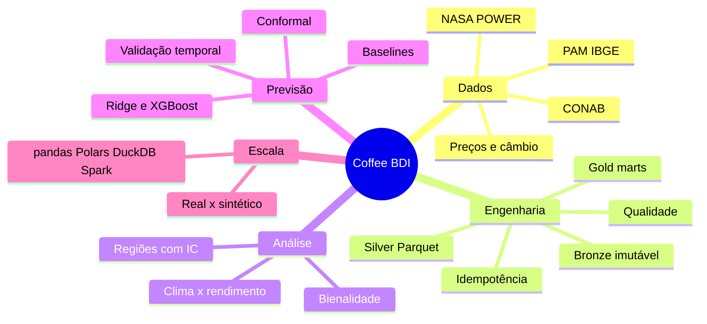

# 00 · Guia de estudo

Ordem sugerida de leitura, do geral ao específico. Cada passo indica **o que você deve ser capaz de explicar** ao final.

| # | Material | Você deve conseguir explicar… |
|---|---|---|
| 1 | `README.md` | o objetivo, o que foi executado e o que **não** pôde ser |
| 2 | `docs/pt-BR/03_volume_real_vs_sintetico.md` | por que café **não** é Big Data neste projeto e por que o benchmark é sintético |
| 3 | `docs/pt-BR/01_arquitetura.md` | bronze/silver/gold, ingestão idempotente, chaves de tempo |
| 4 | `docs/pt-BR/02_fontes_de_dados.md` | granularidade, unidade, atualização, licença e limites de cada fonte |
| 5 | `notebooks/01_exploracao_fontes` | como cada fonte foi verificada na prática |
| 6 | `docs/pt-BR/05_decisoes_etl.md` + `notebooks/02_limpeza_qualidade` | valores especiais do SIDRA, dígito verificador IBGE, o bug do `pivot_table` |
| 7 | `docs/pt-BR/06_qualidade_de_dados.md` | por que ≈ 38,5% dos rendimentos são repetidos e o que isso implica |
| 8 | `notebooks/03_eda_cafeicultura` | evolução de área, produção e rendimento; armadilha da comparação ponta a ponta |
| 9 | `notebooks/04_clima_produtividade` | anomalias, bootstrap por anos, por que 1 663 linhas ≈ 13 observações |
| 10 | `notebooks/05_series_temporais` | bienalidade, rolling origin, IC pareado |
| 11 | `docs/pt-BR/07_modelagem_e_estatistica.md` + `notebooks/06_previsao_producao` | cenários A/B, vazamento, métricas, conformal, falha do ridge |
| 12 | `docs/pt-BR/08_benchmark_e_custos.md` + `notebooks/07_benchmark_bigdata` | metodologia de benchmark justo e o que ele **não** prova |
| 13 | `notebooks/08_insights_negocio` + `docs/pt-BR/10_interpretacao_agronomica.md` | respostas às 4 perguntas, com confiança e limites |
| 14 | `docs/pt-BR/09_erros_comuns.md` | os erros reais e como evitá-los |
| 15 | `docs/pt-BR/11_exercicios.md` | aplicar tudo em variações |
| 16 | `docs/pt-BR/12_reproducao.md` e `13_limitacoes_e_licencas.md` | reproduzir e saber os limites |

## Mapa conceitual

## Perguntas de revisão

1. Por que o painel de modelagem começa em 2012?
2. O que significa "sem vazamento" para uma previsão feita em 1º de maio?
3. Por que o `naive_lag1` é difícil de bater nos dados da PAM?
4. Por que o ridge falhou em 2018–2019 no cenário B e o XGBoost não?
5. Qual a diferença entre a bienalidade estadual e a persistência municipal observadas?
6. Em que situação o Spark se justificaria e por que este experimento **não** prova o contrário?
7. Por que um IC que inclui 0 **não** prova ausência de efeito?
