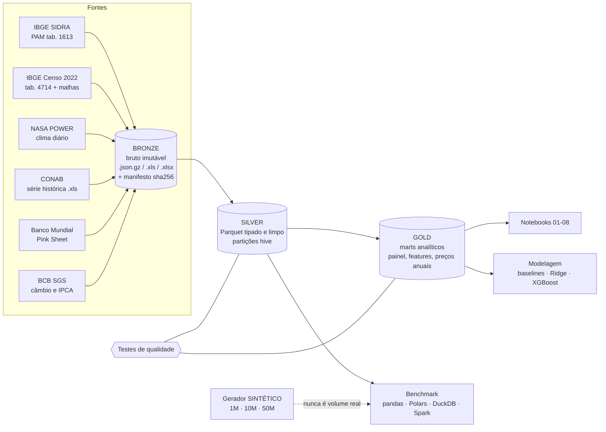
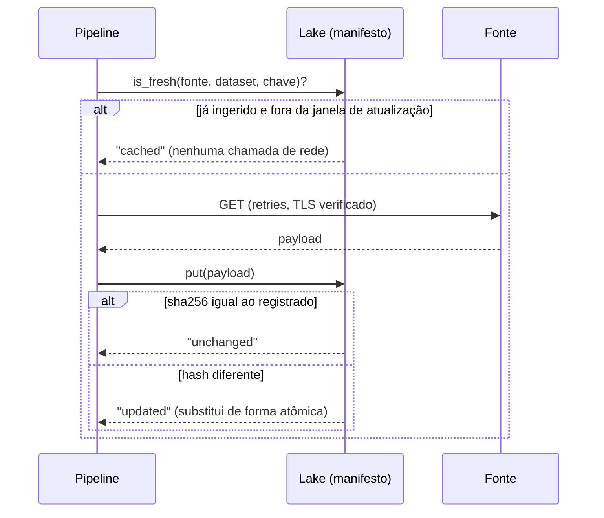

# 01 · Arquitetura

## Visão geral

O projeto segue a **arquitetura medalhão** (bronze → silver → gold) sobre um "lago de dados" local em arquivos, com um catálogo mínimo em DuckDB.

## Camadas

| Camada | Conteúdo | Formato | Regra de ouro |
|---|---|---|---|
| **bronze** | resposta da fonte, **sem alteração** | `.json.gz` (determinístico, `mtime=0`), `.xls`, `.xlsx` | nunca editar; só acrescentar/atualizar com registro no manifesto |
| **silver** | dados tipados, normalizados (códigos IBGE, datas, valores especiais SIDRA), sem regra de negócio | Parquet, partições hive (`especie=`, `ano=`) | **reconstruível** do bronze de forma determinística |
| **gold** | tabelas prontas para análise: painel município-ano, janelas climáticas, preços anuais reais | Parquet | cada coluna com definição e sem vazamento temporal |
| `_meta` | manifesto de ingestão (`meta.duckdb`): fonte, chave, caminho, `sha256`, bytes, nº de registros, `n_fetches` | DuckDB | permite auditar e provar idempotência |

## Ingestão incremental e idempotente

Decisões (ver `05_decisoes_etl.md`):

1. **Chave de requisição determinística** (ex.: `uf35_arabica_2023`): a mesma chamada sempre resolve para o mesmo arquivo.
2. **Status** por item: `new`, `cached`, `unchanged`, `updated`.
3. **Janela de atualização:** os últimos `PAM_REFRESH_RECENT_YEARS` (padrão 2) anos do PAM são **sempre** rebuscados, porque o IBGE revisa dados recentes.
4. **Escrita atômica** (arquivo temporário + `rename`) e **gzip determinístico**: reexecutar não muda o hash se a fonte não mudou.
5. **TLS sempre verificado.** Se uma fonte falha em TLS, ela é documentada como indisponível — **nunca** se desativa a verificação.

## Silver determinística

`write_parquet_dataset` escreve em diretório temporário e **troca** o destino (rmtree + swap): reexecutar o silver produz o mesmo conteúdo, sem acúmulo de arquivos antigos.

## Gold: o que existe

| Tabela | Grão | Para quê |
|---|---|---|
| `painel_cafe_arabica` | município × ano (arábica, 2012+) | base de modelagem e análises; inclui lags, clima, preço defasado, elegibilidade |
| `clima_features` | célula × ano-colheita | janelas fenológicas que terminam em 31/mar de *t* |
| `clima_mensal` | célula × mês | sazonalidade e agregações |
| `precos_anuais`, `ipca_anual` | ano | preço em R$/saca nominal e real (base 2025) |
| `conab_vs_pam` | UF × ano × espécie | reconciliação entre fontes |
| `dq_results` | verificação | resultado dos testes de qualidade |

## Chaves de tempo

| Chave | Definição | Onde |
|---|---|---|
| `ano` | ano-colheita *t* (PAM é anual) | PAM, painel |
| `date_key` | data de referência (31/dez do ano ou data do dia) | PAM e clima |
| `mi` ("mês índice") | `ano × 12 + mes − 1`, inteiro contíguo | janelas climáticas (evita erro de virada de ano) |
| `safra` | ano de início da safra CONAB | CONAB |

## Módulos (`src/coffeebdi/`)

`config` (caminhos e parâmetros) · `lake` (bronze + manifesto) · `sources` (conectores HTTP) · `ingest` · `silver` · `gold` · `quality` · `pipeline` · `modeling` · `synth` · `bench` · `spark_utils` · `nbutils`.

## Por que DuckDB como "motor" do gold?

SQL declarativo sobre Parquet, sem servidor, vetorizado, e **lê partições hive** diretamente. Para o volume real (≤ 0,8 milhão de linhas) é mais que suficiente; o benchmark (notebook 07) compara com pandas, Polars e Spark para que a escolha seja **evidência**, não preferência.
