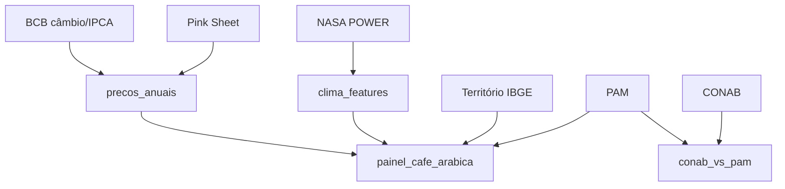

# 02 · Fontes de dados: verificação, granularidade, licença e limites

> Esta página registra **o que foi verificado** durante a construção (consultas reais às APIs e arquivos) e **o que não foi**. Datas de acesso: outubro de 2026. Onde algo não foi confirmado, está escrito **"não verificado"**.

## Resumo

| Fonte | Variáveis usadas | Granularidade | Unidade | Atualização | Status |
|---|---|---|---|---|---|
| **IBGE / SIDRA – PAM (tabela 1613)** | área destinada, área colhida, quantidade produzida, rendimento médio, valor da produção | município × ano × produto (café total / arábica / canephora) | ha, t, kg/ha, mil R$ | anual | **verificada e em uso** |
| **IBGE – Censo 2022 (tabela 4714) e malhas** | área territorial, população, densidade; divisão territorial | município (2022) | km², hab., hab/km² | decenal | **verificada e em uso** |
| **NASA POWER** | T2M, T2M_MAX, T2M_MIN, PRECTOTCORR | diária × ponto de grade (0,5° × 0,625°, MERRA-2) | °C, mm/dia | diária (com latência) | **verificada e em uso** |
| **CONAB – série histórica de café** | produção, área, produtividade (por UF e espécie) | UF × safra | mil sacas, ha, sc/ha | durante a safra (levantamentos) | **verificada e em uso** |
| **Banco Mundial – Pink Sheet** | café arábica e robusta (preço internacional) | mensal, global | US$/kg | mensal | **em uso**, licença **não confirmada** |
| **BCB – SGS** | câmbio (série 1) e IPCA (série 433) | diária / mensal | R$/US$, % | diária / mensal | **em uso**, termos **não verificados** |
| **INMET** | estações meteorológicas | horária por estação | — | — | **INDISPONÍVEL** (falha de TLS; ver abaixo) |

## IBGE · PAM (Pesquisa Agrícola Municipal)

- **API:** `https://servicodados.ibge.gov.br/api/v3/agregados/1613`, classificação 82 ("produto das lavouras permanentes").
- **Categorias de café:** `2723` (café total), `31619` (arábica), `31620` (canephora). **Arábica e canephora só existem a partir de 2012** (verificado consultando os anos disponíveis na API); antes disso, só "total". Por isso o painel de modelagem começa em 2012 e **nunca mistura espécies**.
- **Variáveis:** `2313` área destinada à colheita, `216` área colhida, `214` quantidade produzida, `112` rendimento médio, `215` valor da produção.
- **Valores especiais SIDRA:** `-` (zero absoluto), `0` (zero por arredondamento), `..` (não se aplica), `...` (indisponível), `X` (suprimido por sigilo). O silver converte para número e guarda uma coluna `*_q` com a **qualidade** de cada valor.
- **Natureza do dado:** estimativas coletadas com agentes e órgãos locais, **não** medições. Há **muita repetição** do mesmo rendimento ano a ano (ver `06_qualidade_de_dados.md`).
- **Latência:** o resultado do ano *T*−1 só é publicado por volta de setembro de *T* (por isso o cenário "B" de previsão usa lags ≥ 2).
- **Licença:** dados abertos do IBGE; **termos de uso não revisados juridicamente neste projeto** (cite sempre a fonte).
- **Limites:** nível municipal pode ter sigilo (`X`); revisões retroativas; sem informação de idade, manejo ou variedade.

## IBGE · Território

- Municípios, micro/mesorregiões e regiões imediatas via API de localidades; malha de UF; Censo 2022 (tabela 4714: variáveis 6318 área, 93 população, 614 densidade).
- **Código de município:** 7 dígitos = 2 (UF) + 4 + 1 (dígito verificador). O pipeline **valida** o dígito (ver `05_decisoes_etl.md`).

## NASA POWER

- **Endpoint:** `https://power.larc.nasa.gov/api/temporal/daily/point`; parâmetros `T2M`, `T2M_MAX`, `T2M_MIN`, `PRECTOTCORR`.
- **Origem:** reanálise MERRA-2 (grade nativa 0,5° de latitude × 0,625° de longitude, ≈ 55 km × 60 km). Não é medição em estação: **suaviza microclima, relevo e geadas locais**.
- **Células usadas:** as 80 células da grade que contêm municípios produtores de SP; **um município herda o clima da célula** que o contém (centroide). Municípios vizinhos compartilham o mesmo valor.
- **Chamadas:** em blocos (2000–09, 2010–19, 2020–fim) por célula, com cache e *refresh* só do bloco aberto.
- **Licença:** livre acesso; recomenda-se citar. **Termos não revisados em detalhe aqui.**

## CONAB · Série histórica de café

- **Arquivos:** planilhas `.xls` de arábica e conilon (publicadas em `gov.br/conab`). **TLS verificado com sucesso** neste domínio.
- **Conteúdo:** produção (mil sacas beneficiadas de 60 kg), área em produção/formação (ha) e produtividade (sc/ha) por UF e safra.
- **Safra corrente:** a linha mais recente é **estimativa** (marcada `estimativa=True`, nunca tratada como dado fechado).
- **Conversões:** 1 saca = 60 kg (`SACA_KG`). A comparação com a PAM é em toneladas e **mostra diferenças** (conceitos e metodologias distintos — `gold.conab_vs_pam`).
- **Licença:** **CC BY-ND** (atribuição, sem derivações). Por isso o lago de dados **não é redistribuído** e `data/lake` está no `.gitignore`.

## Banco Mundial · Pink Sheet

- **Arquivo:** `CMO-Historical-Data-Monthly.xlsx`. A URL do arquivo muda a cada edição: **o conector descobre a URL vigente lendo a página oficial** (uma URL fixa ficou obsoleta durante o projeto e entregava dados só até 12/2024).
- **Uso:** preço internacional mensal (US$/kg) do arábica e do robusta; convertido para R$/saca com o câmbio do BCB e deflacionado pelo IPCA.
- **Limite importante:** **não é o preço pago ao produtor paulista** (séries de preço ao produtor de entidades de pesquisa **não** foram usadas: acesso e metodologia não foram confirmados dentro do projeto).
- **Licença:** **não confirmada** neste projeto.

## BCB · SGS

- **Séries:** `1` (câmbio livre, dólar venda, diária) e `433` (IPCA, variação mensal %). API pública `api.bcb.gov.br`.
- **Cuidado:** séries diárias têm janela máxima por chamada (≈ 10 anos, conforme documentado no conector); o câmbio é buscado **ano a ano** (anos fechados ficam em cache) e o IPCA mensal numa única chamada.
- **Termos de uso:** **não verificados em detalhe.**

## INMET (indisponível)

A tentativa de acessar a fonte falhou na **verificação TLS**. A política do projeto é **nunca** desativar a verificação; portanto o INMET está **documentado como indisponível** e o clima vem do NASA POWER. Se o certificado for corrigido pela fonte, basta implementar um conector em `sources.py` e comparar as estações com a grade (estudo sugerido no `11_exercicios.md`).

## Preços: o que **não** foi feito

Não há série de **preço ao produtor** com metodologia e acesso confirmados dentro do projeto. O preço usado é o **internacional** convertido. Qualquer conclusão sobre rentabilidade local exige dados de custo e preço regional que **não estão aqui**.

## Como cada fonte alimenta o projeto

